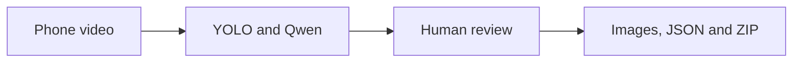

# VLM-CNN Auditor

**Inspect detector errors with a vision-language model and keep the evidence for human review.**

VLM-CNN Auditor is a local computer-vision auditing prototype. It runs YOLO on a video, asks Qwen3-VL to look for cups that YOLO may have missed, and presents both outputs alongside the source frame. A reviewer can accept, reject or defer each suggestion and export the session with its images, JSON records and checksums.

The current experiment focuses on **physical cups and mugs, COCO class 41**. Its purpose is to test whether a VLM can provide useful review leads beyond a detector's predictions. It preserves predictions and decisions separately so a plausible model answer never silently becomes a training label.

## How it works

Upload a 15–30 second MP4 or MOV, save it, then start analysis. Both models process the same source frames: **0, 5, 10, ...**. Qwen inspects one to three raw views per selected frame. Positive regions without an intersecting YOLO cup box can produce a possible missed-cup finding. These are regional leads, without corrected bounding boxes or reliable object counts.

The Gradio interface shows the raw frame, YOLO overlay, Qwen observations and decision history. Each frame retains its source index, presentation timestamp and stable session/frame identity. PostgreSQL stores metadata and decisions. Original video, JPEG pairs, per-frame JSON and exports stay on local disk.

## What has been demonstrated

On one 27-second video, the prompt experiments produced additional review leads for hanging mugs and a red-handled mug. YOLO also missed those examples when given the identical crops. Other examples were explained by cropping alone, and one proposed glass-cup lead remained ambiguous.

The integrated version passed [86 automated tests](https://github.com/YousefAlSalqan/vlm-cnn-auditor/actions/runs/44128518913), including isolated PostgreSQL and browser tests. Two frames from the video also passed real-Qwen integration and saved-evidence replay checks. Automated tests establish software behavior, not detection accuracy. See the [iterations and experiment record](docs/PROMPT_LOOP_RESULTS.md) and [verification record](docs/V1_VERIFICATION.md).

This is an experimental local application. General accuracy, full-video review time and business savings remain unmeasured. It does not automatically correct YOLO, retrain models or produce approved training labels. A 27-second video at 30 fps produces 162 analyzed frames, so regional Qwen review can take substantially longer than the video itself.

## Run it

On a prepared Windows checkout, run `start-auditor.cmd` and open [the local app](http://127.0.0.1:7860). For a new machine, follow the [setup and test guide](docs/V1_GUIDE.md) first. The launcher uses installed services and checks the database schema. It does not install dependencies or initialize a database.

The stack is Python, Gradio, OpenCV/FFprobe, YOLO11n, Qwen3-VL 2B through local Ollama, and PostgreSQL. Exact dependencies are in [pyproject.toml](pyproject.toml) and [requirements-cpu.lock](requirements-cpu.lock). Footage, credentials, model weights and database volumes are excluded from Git.

## Documentation

- [Architecture, database diagram and synchronized storage](docs/ARCHITECTURE.md)
- [Prompt iterations and observed results](docs/PROMPT_LOOP_RESULTS.md)
- [Setup, testing and recovery](docs/V1_GUIDE.md)
- [Future improvements](docs/ROADMAP.md)
- [Full documentation index](docs/README.md)

No repository-wide license is declared. Review permissions and dependency/model licenses before redistribution or commercial deployment. The [Ultralytics licensing page](https://www.ultralytics.com/license) and [Qwen model card](https://huggingface.co/Qwen/Qwen3-VL-2B-Instruct) describe separate upstream terms.
