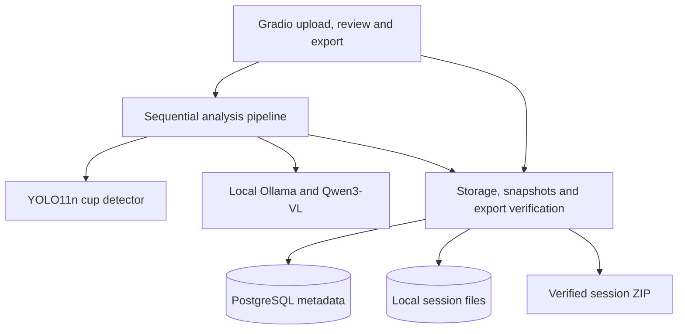
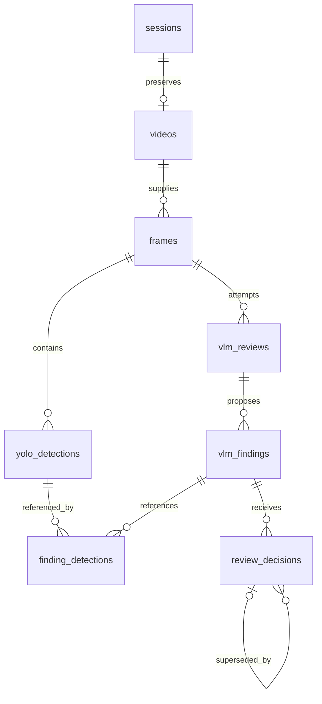

# Current architecture

This document describes the implemented local application. It is the current architecture reference. The original [implementation plan](IMPLEMENTATION_PLAN.md) and [data-model proposal](DATA_MODEL.md) also contain deferred features. [Future improvements](ROADMAP.md) are documented separately.

## System boundaries

One Gradio process calls a sequential Python pipeline. It uses an installed YOLO11n checkpoint and a loopback Ollama server running `qwen3-vl:2b-instruct`. PostgreSQL holds searchable records. Local disk holds the large files and JSON projections. There is no cloud worker, public API, queue or automatic phone synchronization.



The arrows show component access. The storage, snapshot and export modules run in the same application process. YOLO completes the sampled-frame stage before Qwen reviews those frames. The models use the same frame keys, not simultaneous calls. One analysis runs at a time. YOLO currently uses CPU. Ollama manages its own available compute. No model training occurs in this flow.

## Frame and review flow

1. **Save video.** Validate the container, stream, timing, dimensions and supported limits. Copy the original bytes into a UUID-based session directory and freeze the analysis configuration and identities.
2. **Select evidence.** Decode in presentation order and retain source indices divisible by five. Derive milliseconds from source presentation timestamps, including variable-frame-rate video. Save the raw JPEG, YOLO overlay and native-pixel detections for each selected frame.
3. **Inspect raw regions.** Divide a frame into up to three nonempty horizontal bands. Qwen inspects the bands that do not intersect an existing YOLO box. If all bands intersect boxes, one full-frame context call still sends that frame to Qwen, without deriving a missed-cup finding from it.
4. **Validate and persist.** The default [cup-presence prompt](../auditor/prompts/cup_presence_v2.txt) asks for a small JSON observation. The host validates the observation, supplies the frame identity, and groups qualifying positive regions into one R1 proposal. Save raw model strings, transforms, request/prompt hashes and the normalized finding separately.
5. **Review and export.** Show synchronized evidence and append Accept, Reject or Defer decisions. Regenerate the frame's JSON snapshot. Export under a session lock, then verify scope, revisions, hashes, references and replayable review evidence.

The model's regional output has two fields:

```json
{
  "cup_present": "yes",
  "evidence": "A white mug with a red handle is visible on the left."
}
```

This is an illustrative observation, not an accepted label. `cup_present` can also be `no` or `unclear`. Schema validation checks structure. It does not establish that an object exists. A negative region does not clear the whole frame. R1 proposals have no detector references and no estimated object count.

The raw regional envelope is versioned `cup_regions_v1`. It retains each region's native bounds, input transform, request hash and original response string. The existing `ReviewResponse` contract stores the host-derived finding. Older `cup_review_v1` sessions keep their original raw-response reader and R1–R4 contract. The new default generates R1 leads only.

## PostgreSQL design

There are **eight application tables**, plus Alembic's schema-version bookkeeping. SQLAlchemy definitions are in [auditor/db.py](../auditor/db.py) and migrations are in [migrations/versions](../migrations/versions).



| Table | Key and purpose |
| --- | --- |
| `sessions` | UUID primary key. Lifecycle, frozen configuration/checksum, revisions, cancellation and stage metrics. |
| `videos` | UUID primary key, unique session foreign key. Original path/hash/size, codec, presentation-time evidence and probe metadata. |
| `frames` | Composite primary key `(session_id, frame_id)`. Source index/PTS, timestamp, dimensions, file paths/hashes, review selection and snapshot revision. |
| `yolo_detections` | UUID primary key. Immutable cup boxes, confidence, ordinal and scoped frame reference. |
| `vlm_reviews` | UUID primary key. Frame-scoped attempt, status, outcome, raw response, model/prompt identity, transforms, metrics and recovery state. |
| `vlm_findings` | UUID primary key. Review-scoped rule, evidence and explanation. Separate from original detections. |
| `finding_detections` | Composite primary key `(finding_id, detection_id)`. Scoped links for rules that reference detections. Default R1 findings do not use these links. |
| `review_decisions` | UUID primary key. Finding, ordered action history, note, reviewer label and optional superseded decision. |

**Foreign keys are enforced.** Composite foreign keys keep a frame's video, detections, reviews and finding references in the same session/frame scope. Decision supersession references the same finding. Deletes use `RESTRICT`. Database constraints also enforce cup-only detections, valid geometry, bounded attempts and allowed states. The application adds contextual checks such as matching timestamps and native image bounds.

A session owns frames through its unique video record. The diagram shows actual foreign-key paths. A successful upload has one video. The schema permits a session with no video during incomplete creation. A decision may be referenced by multiple later rows at the schema level, while application revision checks maintain the normal ordered decision history.

The app requires migration revision `0002_review_recovery` and refuses incompatible schemas. Startup checks the revision and does not apply migrations. Independent reference-label, adjudication and trial tables are not implemented.

## Synchronized video, frame and JSON storage

The default data root is `Path.home() / "vlm-cnn-auditor-data"`. Set `DATA_ROOT` to use another local directory. It is independent of the Git checkout. Phone transfer is manual, followed by browser upload.

```text
DATA_ROOT/
  session_<UUID>/
    original.mp4                       # or original.mov, unchanged bytes
    frames/frame_000000005.jpg           # source index 5
    annotated/frame_000000005.jpg
    json/frame_000000005.json
    manifest.json                       # latest exported manifest
    .staging/                           # publication recovery
  exports/<session_UUID>/<export_UUID>.zip
```

The shared identity is **`session_id` + `frame_id` + `timestamp_ms`**. A frame ID encodes its source index. A timestamp describes its presentation time, not a unique database key. YOLO boxes use native-pixel `xyxy` coordinates. Qwen transforms record which raw pixels were supplied to the model.

PostgreSQL is canonical for metadata and decisions. Per-frame JSON is a revisioned projection of committed records, containing predictions, review attempts, findings, decisions and artifact references. JPEGs and JSON use the same frame stem. Filenames are generated from validated identities rather than uploaded filenames. Database and archive paths are relative to the session folder.

File publication uses temporary/staged writes, hashes and explicit ready states. JSON snapshots are atomically replaced as revisions advance. The filesystem and PostgreSQL do not share a transaction. Reconciliation detects incomplete publication, missing files, stale snapshots and corruption before review/export. The original video and prediction evidence are preserved.

ZIP verification checks the allowlisted inventory and hashes, frame/source identity, revision agreement, detection references, model provenance and saved raw-response replay. A complete stride-five export must include every required sampled frame and its review. Partial/cancelled exports preserve available evidence and identify incomplete processing.

## Components and dependencies

| Component | Responsibility |
| --- | --- |
| [app.py](../auditor/app.py), [style.css](../auditor/style.css) | Gradio UI and review interactions. |
| [pipeline.py](../auditor/pipeline.py), [video.py](../auditor/video.py) | Analysis state, frame selection, source timing and cancellation. |
| [models.py](../auditor/models.py), [regional.py](../auditor/regional.py) | YOLO/Ollama adapters, regional requests and finding derivation. |
| [db.py](../auditor/db.py), [contracts.py](../auditor/contracts.py) | SQL definitions and strict data/response validation. |
| [storage.py](../auditor/storage.py), [evidence.py](../auditor/evidence.py), [export.py](../auditor/export.py) | Safe paths, hashes, snapshots, decisions, recovery and verified ZIPs. |

Use Python 3.11 for the tested environment, PostgreSQL 16, FFmpeg/FFprobe and installed local Ollama. Application packages include Gradio, OpenCV, NumPy, SQLAlchemy, Psycopg, Alembic, Pydantic, HTTPX and FileLock. Ultralytics is the model extra. Pytest, Playwright, Ruff and JSON Schema checks support verification. Exact versions and CPU package constraints live in [pyproject.toml](../pyproject.toml) and [requirements-cpu.lock](../requirements-cpu.lock). There is no separate FastAPI service.

## Failure and runtime boundaries

Input limits are 15–30 seconds, 200 MiB, long edge at most 1920 pixels and at most 3600 source frames. Stride five yields at most 720 analyzed frames. Decode work still scales with source-frame count. Sampling reduces model calls relative to running on every source frame, not relative to the previous 1 Hz/12-review default. At 30 fps, both models receive six source samples per video second.

Regional calls run sequentially with a default 120-second deadline per call. Each frame has at most two attempts. Uncertain transport, timeout or OOM stops further processing and requires the documented recovery steps. Cancellation is checked between frames and regions. A closed HTTP request does not prove inference stopped inside Ollama.

An occupied band can hide an additional missed cup, and a wide band is not a precise object location. Adjacent-frame observations can describe the same physical object repeatedly. Image quality, model errors and inference latency remain practical limits. See [verification](V1_VERIFICATION.md), [setup/recovery](V1_GUIDE.md) and the separate [roadmap](ROADMAP.md).
