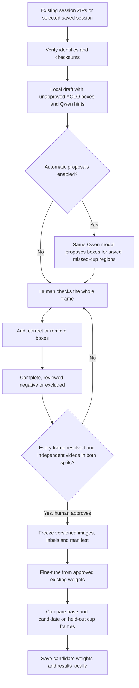

# Local cup datasets and reviewed fine-tuning

This branch adds an optional workflow that turns saved YOLO boxes, Qwen leads and human corrections into a cup dataset. The workflow starts OFF. Training starts only after you approve a fully reviewed dataset version. The result is a separate candidate checkpoint.



## Try it in the app

1. Run the app normally, then open **4. Build a reviewed cup dataset**. Enable the workflow. **Automatically propose missing boxes** starts ON. Switch it OFF to annotate manually without extra Qwen calls.
2. Select an analyzed session and click **Build or extend dataset**, or supply one or more existing session ZIPs. ZIP inputs take precedence over the selected session. When this workflow is enabled, finishing a new analysis also imports that selected session. Uploading or enabling the switch alone does not start training.
3. Choose a dataset frame. Read its Qwen hints and compare the raw image with the draft overlay. Green boxes came from YOLO, amber boxes from Qwen, and blue boxes were added by a person. The box selector names each origin and marks changed model boxes.
4. To add a box, select two corners on the raw image, then click **Add box**. You can also enter its four native pixel coordinates. Select a cup box to change or delete it. After any edit, the frame returns to pending review.
5. Box every visible cup or mug, including its handle and visible extent when partially occluded. Check for missing cups, false positives and duplicates. Select **All visible cups boxed**, **No visible cups**, or **Exclude this frame**, confirm you checked the entire frame, then save. A negative image must have no boxes. A model returning no proposals is never sufficient to mark a negative.
6. Use different source videos for training and validation. The first new video goes to training, the second to validation, and later videos to training. You can change a whole video's split during review before its first approval. Split assignments remain fixed after approval. At least one reviewed cup example must remain in each split.
7. Check the displayed existing checkpoint, training settings and dataset readiness. Click **Approve dataset and fine-tune**. Approval freezes that exact revision, base-file hash and settings, then queues training. Use **Refresh training status** to see progress, errors and final results.

The local CPU settings are 10 epochs, batch size 2, image size 640, zero loader workers and seed 0. No new packages or model downloads are required beyond the project's existing model environment. CPU training time has not been measured on the target laptop.

Later imports extend the same local dataset and preserve previous reviews. New releases include earlier approved cup examples and new reviewed examples. For a later training run, you can select an earlier evaluated cup candidate as the base checkpoint. Existing pretrained weights initialize the first run. A cup-only output head can require initialization when the base has 80 COCO classes.

## Where files are saved

Everything for this feature lives under `DATA_ROOT/datasets/`. With the usual Windows default, that is `C:\Users\Dell\vlm-cnn-auditor-data\datasets\`.

```text
datasets/
  current.json                      # pointer to the active local dataset
  <dataset-id>/
    draft.json                      # source identities, proposals, annotations and history
    images/                         # copied raw frames
    sources/                        # immutable original per-frame JSON snapshots
    revisions/                      # append-only review and proposal events
    releases/v000001/
      images/train/ and images/val/
      labels/train/ and labels/val/
      data.yaml
      history.json
      manifest.json
      approval.json
    jobs/<job-id>/
      spec.json                     # approved release, base hash and settings
      job.json                      # durable job status
      training.log
      data/                         # working dataset copy, including any trainer caches
      base.pt                       # private working copy of existing weights
      run/weights/best.pt           # new cup candidate
      result.json                   # checkpoint hashes, versions and held-out results
      runtime/                      # isolated training-library settings/cache
```

No new database tables or migrations are added. The app reuses its existing session export to read saved evidence. Original session media, predictions and Qwen reviews remain the source evidence. Dataset edits go into separate local files. Keep the whole dataset folder when backing up because label text files alone omit review provenance. Keep the original session folders too for their video and original overlays. Generated datasets are excluded from Git.

Each frame retains `session_id`, `frame_id`, `timestamp_ms`, source index, original-video hash and raw-image hash. Host-generated identifiers tie proposals to their receipts. An altered image or reused frame identity with different source evidence fails validation.

Native annotations keep canonical COCO cup class 41. Training labels use a one-class mapping, `0: cup`, with normalized center/width/height coordinates. For a 100x100 image and native box `[10,20,30,60]`, the training line is `0 0.2 0.4 0.2 0.4`. This follows the [Ultralytics detection dataset format](https://docs.ultralytics.com/datasets/detect/).

## What automation can decide

YOLO supplies the initial boxes. Saved Qwen findings supply review hints. For saved possible-miss regions, the optional localization prompt asks the same Qwen model for individual boxes. It accepts at most 16 integer boxes per view in an explicit `0..1000` coordinate system, then maps them through the recorded crop to native pixels. Malformed boxes are retained as failed receipts and never become labels. Exact matching proposals can share provenance. Heavy overlap produces a warning for the reviewer.

The script does not compare YOLO's confidence with Qwen's wording or decide which model is correct. Its checks cover identity, geometry, missing review decisions, duplicate images and split leakage. A person decides whether each cup and box is supported by the frame. Existing regional leads can miss objects too, so the human must check the entire image.

The [Qwen grounding cookbook](https://github.com/QwenLM/Qwen3-VL/blob/main/cookbooks/2d_grounding.ipynb) motivates testing this use. It does not establish that the installed 2B model provides accurate boxes. Localization quality and correction effort still need a manually boxed pilot.

## Training, cancellation and results

An approved release has a checksum manifest. Edits invalidate the current draft's approval without rewriting older releases. Identical frames cannot cross splits, and conflicting labels on identical images block approval. Prior validation examples stay in validation in later releases. Keep any final test videos outside this training workspace.

A job is keyed by the approved manifest, checkpoint and settings. Repeated approval queues that job at most once. Failed, cancelled or interrupted jobs do not restart when the app opens. A corrected dataset revision creates a new approval and job. Training uses a working copy so its caches cannot change the frozen release.

Analysis, optional localization and training share one process lock. Turning the master switch OFF cancels queued work and asks active work to stop at its next safe boundary. It does not stop the shared Ollama service. A timed-out dataset Qwen call writes a durable pause because HTTP cancellation does not prove generation ended. Stop or restart Qwen yourself, then use the recovery control in the dataset panel to clear the pause. This never retries the previous request automatically.

The trainer loads an existing local detection checkpoint, transfers compatible pretrained weights and produces a cup-only candidate using [Ultralytics training](https://docs.ultralytics.com/modes/train/). It compares base cup class 41, or class 0 for a prior cup model, with candidate class 0 on the same validation frames. The reported counts use confidence 0.25, NMS IoU 0.7 and score-ordered one-to-one matching at IoU 0.5. Precision or recall is null when its denominator is zero. These results use model-assisted labels reviewed by a person, not an independent final test set.

The app's active detector and `YOLO_WEIGHTS` stay unchanged. The candidate's one-class mapping differs from the current detector adapter. Evaluate it independently and add an explicit compatible activation path before using it in normal analysis.

## Verification and limits

Automated checks use synthetic exports, bounded fake HTTP responses and fake trainers. The browser test covers upload, native image clicks, editing, deletion, frame review, approval and a simulated training job on desktop and a 375-pixel touch viewport. No real PostgreSQL, Ollama inference, checkpoint loading or fine-tuning is run for these checks. See [dataset verification](DATASET_VERIFICATION.md) for the recorded results.

Draft metadata is one JSON file, capped at 32 MiB. A review action reads and rewrites that file. This is suitable for the first short-video experiment. Move to per-frame records or a metadata database when the collection outgrows this limit. Images are processed sequentially and at most 256 boxes are kept per frame. Reimporting an existing frame preserves its first captured evidence and current human review. Use a new session for refreshed model proposals, or add corrections manually. There is no background watcher, cloud training or automatic detector replacement.
