# Ordered implementation tasks

> **V1 implementation amendment, 2026-11-16:** The owner authorized implementation after plan review. The core local workflow is implemented and verified with automated tests and independent browser/core review. Reference labels, evaluation tables and measured business KPIs remain deferred. The original task list below is preserved as design history. See [V1_GUIDE.md](V1_GUIDE.md) and [V1_VERIFICATION.md](V1_VERIFICATION.md) for current scope and evidence.

These are future tasks, not code delivered by the planning branch. **Show the final plan to the owner and wait for a separate implementation request before T1.** Dependencies include both the software inventory in [IMPLEMENTATION_PLAN.md](IMPLEMENTATION_PLAN.md) and the task prerequisites below. No pull request is required to review this plan.

Use [DATA_MODEL.md](DATA_MODEL.md) for exact identity, persistence, and JSON rules, [EVALUATION.md](EVALUATION.md) for reference labels and metric formulas, and [RISKS.md](RISKS.md) for local verification gates. Keep the existing repository requirements unchanged. No personal videos, images, weights, credentials, or exports enter Git.

## Execution convention and dependency order

Each task is one small issue with its own test cycle and commit. Steps are ordered: write the named checks, run them to see a meaningful failure, implement the stated interface, rerun the owning checks, then commit that task. Do not install all model runtimes or build a UI before the contracts/storage checks pass. Test snippets below specify assertions, not an implemented test suite.

```mermaid
flowchart LR
    T1[1 Contracts and environment] --> T2[2 Persistence and safe storage]
    T2 --> T3[3 Probe and sample]
    T3 --> T4[4 Cup detector]
    T4 --> T5[5 Pipeline and JSON]
    T5 --> T6[6 Qwen adapter]
    T6 --> T7[7 Review UI and decisions]
    T7 --> T8[8 Recovery and export]
    T8 --> T9[9 Reference labels and metrics]
    T9 --> T10[10 Local acceptance and pilot]
```

Proposed future tree uses one Python package, `auditor/`, the modules listed in the implementation plan, `prompts/`, `migrations/`, `tests/unit/`, `tests/integration/`, and `tests/e2e/`. There are no service subprojects. Test fixtures are generated under pytest temporary directories or represented by small text metadata. Avoid committed image/video binaries.

## T1. Establish strict contracts and the CPU test environment

**Depends on:** Owner's implementation request. **Estimated effort:** 0.5–1 day.

**Create:** `pyproject.toml`, a tested `requirements-lock.txt`, `.env.example`, `auditor/__init__.py`, `auditor/config.py`, `auditor/contracts.py`, `tests/unit/test_contracts.py`, `tests/unit/test_config.py`, `.github/workflows/ci.yml`. **Modify:** README setup instructions when commands actually exist. Preserve current ignore rules.

**Interfaces:** `config.load_settings(environ: Mapping[str,str]) -> Settings`. Define Pydantic contract types `Settings`, `AnalysisConfig`, `FrameKey`, `VideoProbe`, `StoredOriginal`, `SampledFrame`, `DetectedCup`, `ReviewRequest`, `ReviewAttempt`, `FrameBundle`, `DecisionCommand`, `DecisionRecord`, `HumanAnnotationCommand`, `SessionProgress`, `SnapshotResult`, `ReconciliationReport`, `ExportResult`, and `EvaluationReport`. These are data records for the stated workflow, not a generic framework. Use the field definitions in DATA_MODEL. `ReviewCallable` is `Callable[[ReviewRequest], ReviewAttempt]`.

`Settings` contains database URL, absolute data root defaulting to `Path.home() / "vlm-cnn-auditor-data"` with `DATA_ROOT` override, and a default loopback Ollama URL. `AnalysisConfig` freezes sampling, YOLO, Qwen image/context/output limits, rule/prompt/schema versions, and pipeline/runtime provenance. `FrameKey` contains session UUID, frame ID, and timestamp. Session config contains no credentials. Decision commands include their own idempotency UUID and expected latest decision number. Human annotation commands include an expected latest annotation revision.

- [ ] Write `test_frame_key_and_box_validation`, `test_review_outcome_and_reference_cardinality`, and `test_no_secrets_in_public_config`. Assert class 41, finite bounded boxes, extra-field rejection, integer timestamps, no-issue/abstention consistency, and R1–R4 cardinalities. Invalid values must raise a validation error.
- [ ] Run `python -m pytest tests/unit/test_contracts.py tests/unit/test_config.py -q`. Confirm failures exercise missing contracts or validation, not an unrelated environment error.
- [ ] Resolve compatible Python 3.11 CPU dependencies, pin/test the package set and lock, implement the contracts/settings, and add secret-free example variable names. Configure Ruff plus unit pytest in CI. No model downloads, cloud inference, real footage, DB writes at import, or migrations at startup.
- [ ] Run `python -m ruff check .` and the targeted pytest command. Verify a fresh environment can use the lock and install the local package. CI needs only stub-capable CPU dependencies at this stage.
- [ ] Commit: `chore: define auditor contracts and CPU test workflow`.

## T2. Add PostgreSQL persistence and safe immutable storage

**Depends on:** T1. **Estimated effort:** 1–1.5 days.

**Create:** `auditor/db.py`, `auditor/storage.py`, `alembic.ini`, `migrations/env.py`, `migrations/versions/0001_initial.py`, `tests/integration/test_database.py`, `tests/unit/test_storage.py`. **Modify:** CI to run a temporary PostgreSQL 16 service with throwaway credentials.

**Interfaces:** `db.create_session(db_session: Session, original: StoredOriginal, probe: VideoProbe, config: AnalysisConfig) -> UUID`, `db.load_frame(db_session: Session, key: FrameKey) -> FrameBundle`, `storage.store_original(upload_path: Path, data_root: Path, session_id: UUID, container: str) -> StoredOriginal`, and `storage.stage_frame_pair(data_root: Path, key: FrameKey, raw_jpeg: bytes, annotated_jpeg: bytes) -> StagedPair`. Define `StagedPair` here with final/staging paths and digests. All relational entities live in `db.py` initially. Split only if they become hard to maintain.

- [ ] Write `test_upgrade_and_scoped_foreign_keys`, `test_ready_requires_complete_pair`, `test_immutable_original_and_path_escape`, and `test_transaction_rollback`. Assert cross-session/frame references fail, duplicate source indices fail, duplicate timestamps succeed, rollback leaves no partial detections, and original bytes cannot be replaced. Include disk-full and symlink/traversal failures.
- [ ] Run `python -m pytest tests/unit/test_storage.py tests/integration/test_database.py -q` against the disposable PostgreSQL instance and confirm the intended failures.
- [ ] Implement the eleven tables, constraints/indexes, safe streaming writes, hash checks, and same-filesystem staging from DATA_MODEL. Use explicit SQLAlchemy transactions. Create sessions from synthetic `VideoProbe` records in tests. Migrations are commands, never application import/start hooks.
- [ ] Run `python -m alembic upgrade head` on the disposable empty DB, then the owning pytest command. Test seeded-schema upgrade/compatibility and refusal of destructive populated downgrade. Verify `.env.example` contains no real secrets.
- [ ] Commit: `feat: persist scoped evidence and immutable local media`.

## T3. Probe phone timing and extract sampled canonical frames

**Depends on:** T2. **Estimated effort:** 1–1.5 days.

**Create:** `auditor/video.py`, `tests/unit/test_sampling.py`, `tests/integration/test_video.py`, `tests/conftest.py` runtime synthetic-media builders.

**Interfaces:** `video.validate_and_probe(upload_path: Path, settings: Settings) -> VideoProbe` and `video.iter_sampled_frames(path: Path, session_id: UUID, probe: VideoProbe, sample_hz: Decimal) -> Iterator[SampledFrame]`. `SampledFrame` carries its full key, source index/PTS, canonical dimensions, rotation provenance, and unannotated JPEG bytes.

- [ ] Write `test_cfr_one_hz_has_fifteen_unique_frames`, `test_vfr_uses_presentation_time`, `test_same_millisecond_distinct_source_ids`, and `test_rotation_and_decode_probe_mismatch`. Assert a 15-second/30-fps synthetic clip yields source indices `0,30,...,420` at 1 Hz, with 15 unique keys. Check nonzero starting PTS, rational half-up rounding, timestamp gaps, and orientation using distinguishable frame content. Missing/decreasing times must stop, not fall back to nominal FPS.
- [ ] Run `python -m pytest tests/unit/test_sampling.py tests/integration/test_video.py -q` and inspect the expected failures.
- [ ] Implement bounded local upload validation, ffprobe frame metadata, OpenCV sequential decoding, explicit orientation, rational-time sampling, and quality-95 canonical JPEG encoding. Use subprocess argument arrays without a shell. Avoid random-seek sampling and whole-video image buffering. Reject unsupported inputs with actionable codes.
- [ ] Rerun the owning tests with generated CFR/VFR/rotation clips. Verify file limits and bounded probe output/timeout. Record the tested decoder backend/version. Treat untested real phone codecs as unverified.
- [ ] Commit: `feat: preserve presentation timestamps during frame sampling`.

## T4. Produce cup-only predictions and matching overlays

**Depends on:** T3. **Estimated effort:** 0.5–1 day.

**Create:** `auditor/detector.py`, `tests/unit/test_detector.py`. **Interfaces:** `detector.detect_cups(raw_jpeg: bytes, config: AnalysisConfig) -> list[DetectedCup]` and `detector.render_overlay(raw_jpeg: bytes, detections: list[DetectedCup]) -> bytes`. Tests inject a fake prediction object at the model-call boundary. A live model is optional and local, never downloaded during unit tests.

- [ ] Write `test_class_41_filter_and_native_xyxy`, `test_zero_detections_keeps_pair`, `test_overlay_uses_same_ids`, and `test_wrong_label_map_or_invalid_box_fails`. Assert `classes=[41]`, the frozen settings, exact native dimensions, unchanged raw bytes, stable assigned UUIDs, and no invalid/NaN/out-of-frame boxes.
- [ ] Run `python -m pytest tests/unit/test_detector.py -q` and confirm failures before implementing the adapter.
- [ ] Implement YOLO11n loading once per stage, checkpoint hash/label-map verification, native-box conversion, and rendering on a copy of the decoded canonical JPEG. Persist application IDs before display. Separate drawing coordinates from persisted floating-point boxes. Leave NMS/configuration unchanged during a session.
- [ ] Rerun detector tests with zero, one, injected duplicate, and non-cup predictions. Verify stub tests cause no network/model loading. Defer actual CPU/CUDA speed to T10.
- [ ] Commit: `feat: record cup predictions with synchronized overlays`.

## T5. Orchestrate detector persistence and publish canonical JSON

**Depends on:** T4. **Estimated effort:** 1 day.

**Create:** `auditor/pipeline.py`, `tests/integration/test_pipeline.py`, `tests/integration/test_snapshot_publication.py`. **Modify:** `db.py` and `storage.py` for frame transactions, snapshot construction, and content revisions.

**Interfaces:** `pipeline.create_session_from_upload(upload_path: Path, settings: Settings, engine: Engine) -> UUID`, `pipeline.run_detection(session_id: UUID, settings: Settings, engine: Engine) -> Iterator[SessionProgress]`, `storage.publish_snapshot(engine: Engine, data_root: Path, key: FrameKey) -> SnapshotResult`, and `pipeline.select_review_frames(frame_keys: Sequence[FrameKey], budget: int) -> list[FrameKey]`.

- [ ] Write `test_frame_pair_database_and_json_identity`, `test_selection_is_bounded_and_includes_endpoints`, `test_retry_does_not_duplicate_detections`, and `test_revision_change_during_snapshot_remains_pending`. Assert 15 canonical snapshots for the CFR fixture, 12 selected pairs, correct raw/overlay hashes, zero/single/budget-one selection behavior, and revision agreement.
- [ ] Run `python -m pytest tests/integration/test_pipeline.py tests/integration/test_snapshot_publication.py -q` and confirm the intended failures.
- [ ] Implement per-frame staged writes, pending/ready transactions, full identity propagation, immutable detector rows, uniform selection/skip reasons, progress, persisted frame/session timings, and snapshot projection from DB. Keep database transactions short. Leave the session in processing until the review stage finalizes it. No JSON-derived database writes.
- [ ] Rerun owning tests, injecting failure around image renames and JSON publication. Assert UI loaders refuse incomplete media and stale JSON is detectable/regenerable. Verify the full source mapping rather than comparing filenames alone.
- [ ] Commit: `feat: publish revisioned frame evidence from canonical records`.

## T6. Integrate Qwen through a bounded Ollama adapter

**Depends on:** T5. **Estimated effort:** 1–1.5 days.

**Create:** `auditor/reviewer.py`, `prompts/cup_review_v1.txt`, `tests/unit/test_reviewer.py`, `tests/integration/test_review_pipeline.py`. **Modify:** `pipeline.py` and `db.py` to persist attempts/findings and complete session states.

**Interfaces:** `OllamaReviewer.review(request: ReviewRequest) -> ReviewAttempt`, `reviewer.validate_response(raw: str, request: ReviewRequest) -> CupReviewResponseV1`, and `pipeline.run_reviews(session_id: UUID, settings: Settings, engine: Engine, reviewer: ReviewCallable) -> Iterator[SessionProgress]`. Define `CupReviewResponseV1` in contracts using DATA_MODEL's schema. Request images are raw then annotated, with the stored view transform and view-coordinate boxes.

- [ ] Write `test_two_distinct_images_and_schema_request`, `test_rules_no_issue_and_abstention`, `test_unknown_or_cross_frame_references_rejected`, and `test_bounded_timeout_invalid_output_and_oom`. Assert strict JSON, exact identity echo, R2 single/R3 multiple IDs, R4 count disagreement, response byte limit, no findings on invalid attempts, two-attempt ceiling, and no automatic remote/model fallback.
- [ ] Run `python -m pytest tests/unit/test_reviewer.py tests/integration/test_review_pipeline.py -q` using an in-process fake HTTP server or injected HTTP transport. Confirm failing assertions before adding live calls.
- [ ] Implement local `/api/chat`, the documented options/limits, raw-response retention, semantic/context validation, immutable findings/references, attempt timings, failure states, and cancellation. Timeouts do not prove the runtime stopped. Pause retries until idle is confirmed. Wire `review_ready` versus `partial` correctly.
- [ ] Rerun owning tests across valid R1–R4, empty/no-issue, abstention, malformed/truncated content, repeated IDs, invalid counts, unsupported API features, and cancellation. Keep live two-image probing for T10.
- [ ] Commit: `feat: validate bounded Qwen cup-review proposals`.

## T7. Build the synchronized review UI and append-only decisions

**Depends on:** T6. **Estimated effort:** 1 day.

**Create:** `auditor/app.py`, `auditor/decisions.py`, `tests/integration/test_decisions.py`, `tests/e2e/test_review_flow.py`. **Interfaces:** `app.build_app(settings: Settings, engine: Engine, reviewer: ReviewCallable) -> gr.Blocks`, `decisions.record_decision(engine: Engine, command: DecisionCommand) -> DecisionRecord`, and `decisions.record_annotation(engine: Engine, command: HumanAnnotationCommand) -> UUID`. UI callbacks consume a `FrameBundle` from `db.load_frame` and return the full key with the view.

- [ ] Write `test_navigation_never_mixes_frame_pairs`, `test_stale_callback_or_decision_conflicts`, `test_accept_reject_defer_are_append_only`, and `test_human_annotation_is_independent`. Assert double-click idempotency, revision conflict behavior, untouched detector rows, independent label revision, and distinguishable not-selected/failed/no-issue/abstaining states.
- [ ] Run `python -m pytest tests/integration/test_decisions.py tests/e2e/test_review_flow.py -q` with fake model responses and generated footage.
- [ ] Implement one concurrency group, one data-root writer, per-session serialization, upload/progress/cancel/resume, keyed side-by-side navigation, and post-commit decision acknowledgment. Add a separate blind annotation view. Bind loopback, disable public share, restrict file serving, and render model text without HTML interpretation.
- [ ] Rerun owning tests and perform a local fake-model UI smoke check. Check labels, keyboard focus/navigation, text status, image geometry, late responses, and readable failures. No custom motion is required.
- [ ] Commit: `feat: review synchronized evidence with durable human decisions`.

## T8. Reconcile interrupted sessions and export verified ZIPs

**Depends on:** T7. **Estimated effort:** 1–1.5 days.

**Create:** `auditor/export.py`, `tests/integration/test_recovery.py`, `tests/integration/test_export.py`, `tests/e2e/test_stub_end_to_end.py`. **Modify:** `storage.py`, `pipeline.py`, and `app.py` for recovery/export controls.

**Interfaces:** `storage.reconcile_session(engine: Engine, data_root: Path, session_id: UUID) -> ReconciliationReport`, `export.export_session(engine: Engine, data_root: Path, session_id: UUID, expected_revision: int) -> ExportResult`, and `export.verify_export(zip_path: Path) -> ReconciliationReport`.

- [ ] Write `test_crash_at_each_publication_boundary`, `test_export_freezes_revision_and_histories`, `test_zip_allowlist_and_hashes`, and `test_first_stub_end_to_end`. Assert the 15-frame/12-review fixture survives restart with accept/reject history and unchanged original bytes. Verify complete manifest inventory, no extra archive entries, and rejection of stale/corrupt/unsafe artifacts.
- [ ] Run `python -m pytest tests/integration/test_recovery.py tests/integration/test_export.py tests/e2e/test_stub_end_to_end.py -q` and confirm the missing recovery/export behavior fails.
- [ ] Implement startup interruption marking, checksum/revision reconciliation, safe explicit resume, consistent export under session lock, ZIP verification, and atomic ZIP publication. Report orphan data and partial sessions without deleting evidence automatically. Block export on integrity errors.
- [ ] Rerun owning tests with a mutation attempted during export, disk-full failure, missing annotated file, corrupt original, stale JSON, late model response, and repeated resume. Run the complete CPU suite once this milestone passes.
- [ ] Commit: `feat: recover interrupted evidence and export verified sessions`.

## T9. Calculate reference-based quality and business metrics

**Depends on:** T8. **Estimated effort:** 1 day.

**Create:** `auditor/evaluation.py`, `tests/unit/test_evaluation.py`, `tests/integration/test_evaluation_records.py`, `docs/LOCAL_TEST_PROTOCOL.md`. **Modify:** `contracts.py`, `db.py`, `app.py`, and export projection for independent adjudications, timed trial capture, frozen references, and reports.

**Interfaces:** `evaluation.record_adjudication(engine: Engine, command: ReferenceAdjudicationCommand) -> UUID`, `evaluation.record_trial(engine: Engine, observation: ReviewTrialObservation) -> UUID`, and `evaluation.evaluate_sessions(bundles: Sequence[FrameBundle], references: ReferenceSet, trials: Sequence[ReviewTrialObservation], cost_inputs: CostInputs) -> EvaluationReport`. Define those strict record types in contracts from DATA_MODEL, including stable atomic error IDs, duplicate classifications, finding correctness/error links, frozen annotation/adjudication revisions, trial condition/budget/active/wait time, and independently verified claims. Cost inputs contain declared labor/compute/storage rates and optional measured energy. Reports include all source revisions, counts, denominators, coverage, exclusions, null reasons, quality, timing, and cost. Match one visible reference cup to at most one prediction at IoU `>=0.50`.

- [ ] Write `test_duplicate_and_r4_do_not_double_count`, `test_unselected_frames_reduce_pipeline_recall`, `test_zero_denominators_are_null`, `test_cost_and_time_saved_can_be_negative`, and `test_frozen_adjudications_and_trial_budget`. Assert synthetic counts exactly match hand calculations. Include ambiguous human labels, no errors/flags/accepts, localization mismatch, failed attempts, missing sensors, cross-frame judgment rejection, superseded references, and claims outside the active-time budget.
- [ ] Run `python -m pytest tests/unit/test_evaluation.py tests/integration/test_evaluation_records.py -q` and confirm meaningful missing-formula/record failures.
- [ ] Implement independent adjudication and append-only trial records, Start/Pause/Finish and manual error-claim controls, baseline-hidden VLM evidence, and canonical evaluation export. Add EVALUATION's matching, deduplication, selected/pipeline metrics, frozen reference selection, and explicit cost accounting. Write the four-scenario protocol with blind annotations, counterbalanced timed review, and a held-out split. Do not derive correctness from Accept clicks.
- [ ] Rerun owning tests with fixed synthetic examples for all formulas, including zero verified errors, negative savings, interrupted trials, and export/reload of frozen judgments/timing/claims. Verify reports can be reproduced from exported records and declared rates, without fabricated measurements or nonfinite JSON values.
- [ ] Commit: `feat: report human-verified review quality and costs`.

## T10. Verify the local runtime and run the one-cup pilot

**Depends on:** T9 and access to the owner's phone/compute. **Estimated effort:** 1 day compatibility/measurement, plus 1–2 annotation days.

**Create:** `scripts/local_smoke.py` and its assert-based/pytest check, `docs/LOCAL_RESULTS_TEMPLATE.md`. Record actual populated results under ignored local session/export storage, not committed personal media. **Modify:** setup documentation only with verified compatibility facts.

**Interfaces:** `local_smoke.run(settings: Settings, video_path: Path) -> EvaluationReport` invokes the actual application pipeline and integrity verifier. It requires explicit local model installation and uses the exact frozen weights/tag digest. It must not download models, choose a cloud provider, or provision infrastructure implicitly.

- [ ] Complete the license/dependency gate. Record OS, Python/package lock, GPU/driver, Ollama, model digests, ffprobe/OpenCV builds, disk, RAM, and supported codec/orientation. Run all stub tests first.
- [ ] Run the two-distinct-image Qwen capability check, then a real raw/overlay pair. Verify image order/content, schema/context validity, warm/cold behavior, timeouts, and memory. Stop on unsupported features rather than masking them with a text-only or cloud fallback.
- [ ] Run `python scripts/local_smoke.py --video <local-phone-clip>` on a 15–30 second clip. Check original hash, source alignment at start/middle/end, cup-only outputs, a real review, accept/reject persistence, restart, and verified ZIP. A genuine YOLO error is not required for this plumbing check.
- [ ] Record S1–S4 with one physical cup, collect independent references, then run the bounded baseline/assisted protocol. Measure wall time, active review time, peak RSS/CPU/GPU/disk, actual retries, and all metric denominators. Report whether the proposed quality/time/cost gates are met, inconclusive, or failed. Report unavailable sensors and no measured energy if there is no wall-power measurement.
- [ ] Commit only the reusable script, its check, protocol/template, and verified setup documentation: `test: document and verify local one-cup pilot workflow`. No real clip, image, response containing personal data, weight, secret, or DB dump is committed.

## Completion evidence and proposed CI boundary

Default CI after T8 runs `python -m ruff check .` and `python -m pytest tests/unit tests/integration tests/e2e -q` with PostgreSQL 16 and FFmpeg tools, synthetic temporary clips, fake YOLO, and fake Ollama. Verify these exact commands after the implementation supplies the named files. They are not runnable project commands today.

Application completion requires T8's complete stub workflow plus T10's real phone/runtime results. A passing fake suite cannot establish Qwen correctness or local GPU feasibility. If hardware access is unavailable, report local acceptance as blocked/unverified while retaining the completed cloud checks. Do not substitute fabricated model outputs for that evidence.

Planning delivery itself consists only of these five planning documents and README navigation/status. Review them before any application coding. No branch merge, pull request, scaffold, CI configuration, dependency installation, model inference, or deployment is part of that delivery.
