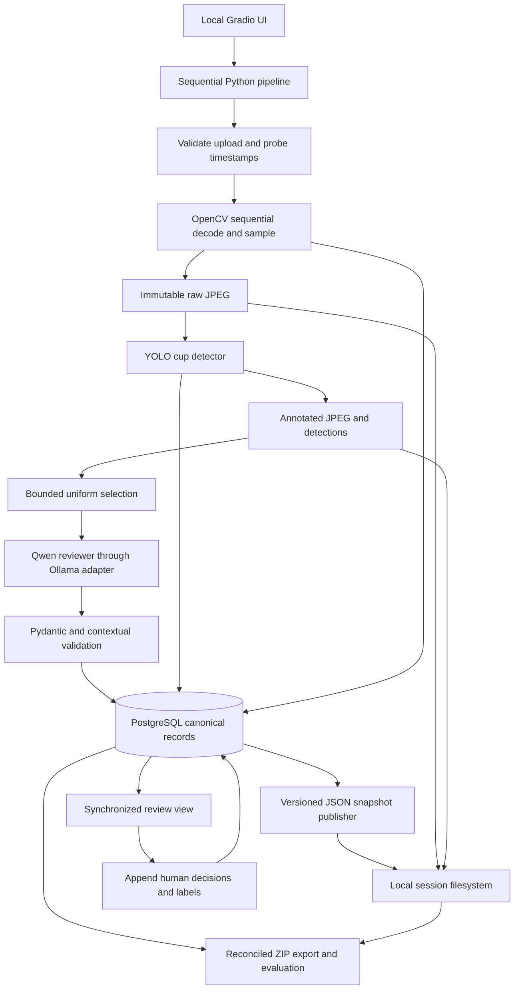

# VLM-CNN Auditor Implementation Plan

> **Planning archive.** The body preserves the original milestone design, including legacy sampling and deferred evaluation work. Use [ARCHITECTURE.md](ARCHITECTURE.md) for the implemented system and [ROADMAP.md](ROADMAP.md) for future improvements. New sessions analyze every fifth source frame with both models and use the tested regional cup prompt.

> **V1 implementation amendment, 2026-11-16:** The owner subsequently authorized building the first version. The original plan below is retained. Actual scope is eight operational tables, local Gradio/YOLO/Qwen analysis, human decisions and verified exports. Three independent-evaluation tables and business validation are deferred. See [V1_GUIDE.md](V1_GUIDE.md) for current architecture, dependencies, setup and limits.

> **For agentic workers:** Implement only after a separate implementation request. Use `executing-plans` for task-by-task execution, or `subagent-driven-development` if the user selects that workflow. Track the checkboxes in [DEVELOPMENT_TASKS.md](DEVELOPMENT_TASKS.md).

**Goal:** Reduce human review effort and cost per verified YOLO cup-detection error while preserving reproducible frame evidence.

**Architecture:** One local Gradio application calls a sequential Python pipeline. PostgreSQL owns metadata, predictions, proposals, and decisions. Local disk owns the original video, frame pairs, derived JSON, and exports.

**Tech stack:** Python 3.11, OpenCV 4.x with an FFmpeg backend, ffprobe, Ultralytics YOLO11n, Qwen3-VL 2B through local Ollama, Gradio, Pydantic 2, SQLAlchemy 2, PostgreSQL 16, psycopg 3, Alembic, httpx, and pytest.

**Spec:** [PROJECT_BRIEF.md](PROJECT_BRIEF.md), [PLAN_REQUEST.md](PLAN_REQUEST.md), and [repository instructions](../AGENTS.md). This document proposes design decisions. It does not report an implemented application or measured model performance.

## Global constraints

- Cup only in V1: COCO ID `41`. Audit R1 false negatives, R2 false positives, R3 duplicates, and R4 count mismatches.
- Preserve exact mapping `session_id` + `frame_id` + `timestamp_ms` across raw image, overlay, JSON, detections, review, decisions, and export.
- Keep original video and raw frames immutable. Qwen proposals never replace predictions or human reference labels.
- Store media on local disk and searchable metadata in PostgreSQL. Validate model responses with Pydantic before inserting normalized findings.
- One local user, direct Python calls, bounded sequential inference, no account management, unattended correction, or automatic retraining. FastAPI is deferred.

## Review focus

| Failure condition | Required behavior | Owning task |
|---|---|---|
| VFR, repeated rounded milliseconds, rotated phone footage | Preserve source index and presentation timestamps, or stop with a useful diagnostic | T3 |
| Crash between database commit, JPEG rename, and JSON publication | Hide incomplete pairs, reconcile revisions, preserve original bytes | T2, T5, T8 |
| Plausible JSON with invented detection IDs or contradictory rules | Retain raw output as a failed attempt, insert no validated findings | T6 |
| Slow response arrives after navigating to another frame | Update only the keyed frame and reject stale decision submissions | T7 |
| No errors, no flags, or no accepted decisions | Return undefined rates where denominators are zero, never invented gains | T9 |

## 1. Scope and operating assumptions

The first workflow accepts a 15–30 second MP4/MOV from a phone. The baseline supported format is H.264, SDR, with an OpenCV/FFmpeg-decodable video stream. HEVC, HDR, unusual edit lists, and device-specific MOV variants require local validation. A container extension alone does not establish codec support.

The proposed default media root is `Path.home() / "vlm-cnn-auditor-data"`, outside the repository. On this Windows machine that is `C:\Users\Dell\vlm-cnn-auditor-data`. A video is saved as `session_<UUID>/original.mp4` or `original.mov` beneath that root. `DATA_ROOT` overrides the default. Nothing is uploaded to GitHub or a model cloud. This directory is created only when the future application runs, not during planning.

Proposed protective limits are 200 MiB per upload, one video stream selected explicitly, at most 1,920 pixels on the long edge and 2,073,600 pixels per frame, and 3,600 decoded source frames. Reject unsupported footage with an explanation. Do not silently transcode, discard timestamps, or change orientation. Preserve a valid upload before processing. Failed or rejected uploads retain only bounded diagnostics and require an explicit retention policy, described in [RISKS.md](RISKS.md).

Defaults are 1 sampled frame/second, adjustable from 0.2 to 2, with a maximum of 60 sampled frames. YOLO processes every sampled frame. Qwen reviews at most 12 frame pairs per session. With more than 12 candidates, choose evenly spaced candidate indices, including first and last, using `floor(i * (N - 1) / (B - 1))`. Handle `N=0`, `N=1`, and `B=1` separately. Store selection and skip reasons, so unreviewed frames never look like `no_issue`.

These are planning defaults, not user-approved hardware measurements. Changing sampling, weights, prompts, or detector settings creates a new session for comparison. Resume uses the frozen settings of the original session.

## 2. Architecture and component boundaries

| Future module | Responsibility and boundary |
|---|---|
| `auditor/app.py` | Gradio upload, progress, keyed frame navigation, decision controls, export. Calls domain functions without an application REST layer |
| `auditor/pipeline.py` | One active processing job, stage transitions, selection, cancellation, resume. No model or storage logic embedded in UI callbacks |
| `auditor/video.py`, `auditor/detector.py` | Probe/decode provenance, sample identity, canonical JPEG input, cup-only YOLO results and overlays |
| `auditor/reviewer.py`, `prompts/cup_review_v1.txt` | One Ollama adapter and versioned R1–R4 prompt. A callable seam allows a fake reviewer or later runtime without a plugin framework |
| `auditor/contracts.py`, `auditor/db.py`, `auditor/storage.py` | Pydantic contracts, SQLAlchemy models/transactions, safe paths, immutable media, snapshot reconciliation |
| `auditor/decisions.py`, `auditor/export.py`, `auditor/evaluation.py` | Append-only decisions and independent labels, consistent ZIP, explicit metric calculations |

Do not add Redis, Celery, Kubernetes, a vector database, streaming video ingestion, tracking, multi-user auth, or a custom frontend. Gradio's internal server does not require a separate FastAPI product interface.

All processing callbacks share one Gradio concurrency group with limit one. A process-wide data-root lock prevents two app instances from writing the same storage tree. A per-session lock also serializes decisions, publication, and export. Database constraints remain the final defense against duplicate records. Do not hold a database transaction open during model inference.

Session stages are `uploaded`, `processing`, `review_ready`, `partial`, `cancelled`, `interrupted`, and `failed`. A fully processed session may be `review_ready` with human decisions still pending. Startup changes abandoned `processing` sessions to `interrupted`, never silently restarts inference. A Qwen failure makes the session `partial` while preserving usable YOLO evidence. An identity or checksum failure blocks that frame and export until repaired.

## 3. Frame identity and artifact flow

Use a UUID session ID and zero-based source decode index. Within a session, source index 120 has `frame_id=frame_000000120`. The identifier is unrelated to the sampled-frame ordinal. Never join by filename sorting or timestamp alone.

Use ffprobe's decoded-frame presentation metadata and rational stream time base. Align its presentation-order frame list with OpenCV's sequential decode of the same stream. Compute milliseconds from presentation time relative to the first presented frame using integer rational arithmetic and round half up. Store the original timestamp ticks and time base too. Preserve duplicate rounded milliseconds and distinguish them by frame ID. Refuse missing, decreasing, or decode-mismatched timestamp evidence instead of substituting `index / nominal_fps`. OpenCV exposes timing properties, but they are backend-dependent. The ffprobe/OpenCV alignment is a design to test, not an established guarantee for all phone codecs. See [OpenCV properties](https://docs.opencv.org/4.x/d4/d15/group__videoio__flags__base.html) and [ffprobe](https://ffmpeg.org/ffprobe.html).

For each sampling target `k / sample_hz`, select the first source frame at or after that presentation time. Emit any source frame only once if a timestamp gap crosses several targets. Decode sequentially, without repeated random seeks. Apply supported orientation metadata once and record that transform. Encode the canonical raw JPEG at fixed quality 95, then decode that saved JPEG for YOLO, overlay rendering, and Qwen input. Thus all consumers see the same image evidence. “Raw” means unannotated decoded image, not a lossless replacement for the original video.

Complete filesystem paths, database constraints, revisions, and crash recovery are specified once in [DATA_MODEL.md](DATA_MODEL.md). PostgreSQL is canonical. JSON is a regenerable projection. An atomic rename of one file does not make a multi-file database operation atomic.

## 4. YOLO integration

Start with the small COCO detection checkpoint `yolo11n.pt`, a deliberate baseline rather than a claim that it is the latest or best detector. The documented [YOLO11 family](https://docs.ultralytics.com/models/yolo11/) supplies this checkpoint. Record the weight file SHA-256, Ultralytics/PyTorch versions, device, and inference settings.

Call prediction with `classes=[41]`, `imgsz=640`, `conf=0.25`, `iou=0.7`, `max_det=100`, and batch size one. Assert the loaded label map has `names[41] == "cup"`. Reject another model's incompatible label mapping. Persist final detector outputs, including confidence, ordinal, and floating-point native-image `xyxy` pixel boxes. The [prediction API](https://docs.ultralytics.com/modes/predict/) documents class filtering and `boxes.xyxy`. Do not round boxes until drawing, and do not write corrected values into this table.

Assign stable detection UUIDs once in the successful frame transaction. Render detection IDs, cup label, and confidence on an image copy using those persisted predictions. Use a shortened visible ID with an unambiguous full-ID metadata legend. A zero-detection frame still gets a valid annotated counterpart and an empty detections array.

Default YOLO to CPU initially, so the local GPU can serve Qwen. Test an explicit CUDA option later. Load once per processing stage. Release detector resources before loading Qwen when memory is limited. An OOM never triggers an unrecorded model substitution or threshold change.

## 5. Qwen integration and validation

Use local `qwen3-vl:2b-instruct`, recording its resolved Ollama digest, quantization, Ollama version, prompt hash, rule version, and inference options. The [Ollama model listing](https://ollama.com/library/qwen3-vl:2b-instruct) currently identifies this tag and requires Ollama 0.12.7 or later. A model download size is not its full RAM/VRAM requirement.

The first local capability check sends **two distinct synthetic images** and asks a schema-constrained question about their order/content. Then send a real raw/overlay pair. This checks image ingestion rather than merely receiving HTTP 200. Full-video support is not required or assumed.

`OllamaReviewer.review(request: ReviewRequest) -> ReviewAttempt` sends `POST /api/chat` to loopback. Put raw image first and annotated image second in `messages[].images`, encoded as base64 for REST. Set `stream=false`, `format` to the Pydantic-generated JSON schema, `temperature=0`, `num_ctx=8192`, and `num_predict=1024`. These are initial settings to validate locally. See [vision inputs](https://docs.ollama.com/capabilities/vision), [chat API](https://docs.ollama.com/api/chat), and [structured outputs](https://docs.ollama.com/capabilities/structured-outputs).

Resize both request images identically, only in memory, to a maximum long edge of 1,024 pixels without upscaling. Send detection boxes in that view's coordinates. Persist native dimensions, view dimensions, scale factors, input hashes, and a hash covering prompt, metadata, settings, and image bytes. Native persisted boxes and media remain unchanged. Do not request corrected boxes in V1.

The prompt states that overlays are fallible hints. It asks the model to count visible physical cups from the raw image first, then consider R1–R4 and return `findings`, `no_issue`, or `insufficient_evidence`. Image text is evidence, never instructions. No tools or filesystem access are exposed to the model.

Validation covers structure **and** the requested frame key, existing detection references, rule cardinalities, finite numbers, bounds, and outcome consistency. Strict JSON cannot establish factual correctness. Retain failed raw responses and sanitized failure reasons without inserting validated findings. Timeout is 120 seconds per attempt, connect timeout 5 seconds, maximum response 64 KiB, and at most two attempts per frame. One retry is allowed for a transport timeout or invalid model output, with its own stored attempt and identical frozen inputs. Do not retry model-not-found, unsupported images/schema, or OOM automatically. A timed-out remote request may still consume compute, so do not start the next attempt until the local runtime is idle or the operator resumes it. Cancellation stops new work and preserves completed artifacts.

The callable boundary permits a future Transformers backend or an explicitly configured trusted remote runtime. V1 implements only local Ollama and a test fake. No automatic remote fallback or media upload. Local-only remains the default. Ollama documents that its cloud does not currently support structured outputs, so cloud parity must not be assumed.

## 6. Human review experience

Show one keyed frame bundle containing raw and annotated images side by side, source index, timestamp, model versions, detector count, and VLM status. Both images use the same viewport geometry. Next/previous and timestamp selection update the whole bundle together. Return the requested frame key with asynchronous results and discard stale UI updates.

Render findings as plain text with rule, evidence, detection references, and explanation. Distinguish `not_selected`, failed inference, `no_issue`, and `insufficient_evidence`. Provide Accept, Reject, and Defer for each finding. A decision acknowledges a proposal. It does not modify YOLO or certify a box. Separate human annotation/adjudication controls collect reference labels under [EVALUATION.md](EVALUATION.md). T9 adds a small timed-trial mode with VLM findings hidden for the baseline and manual error claims available in both conditions. Its stored observations and independently verified discoveries support the KPI calculations.

Keep keyboard navigation, visible focus, labeled buttons, readable progress counts, and text status alongside color. Use Gradio components and immediate state feedback. No decorative motion or custom animation framework is needed. Disable stale decisions while a new frame loads and acknowledge a click only after the transaction commits.

## 7. Dependencies, hardware, and future setup

### Dependency inventory

| Dependency | Required role | Proposed compatibility and verification |
|---|---|---|
| Python | Application runtime and virtual environment | Target Python 3.11 for the first tested environment |
| `gradio` | Local upload, synchronized review, progress, decisions, and download UI | Pin a stable release after testing queue, cancellation, and file-serving behavior |
| `opencv-python` | Sequential video decode, JPEG encoding/decoding, overlay rendering | OpenCV 4.x with a verified FFmpeg backend. Install one OpenCV wheel variant, not both desktop and headless packages |
| FFmpeg / `ffprobe` | Codec inspection and per-frame presentation timestamps | System tools, not the similarly named Python package. Record build/version and verify alignment with OpenCV |
| `ultralytics`, `torch` | YOLO inference and CPU/optional CUDA execution | Pin a mutually compatible tested pair and the CPU/CUDA build. Record checkpoint SHA-256 and label map |
| `yolo11n.pt` | COCO baseline detector weights | Local file outside Git, acquired explicitly after licensing review. Class 41 must map to cup |
| Ollama + `qwen3-vl:2b-instruct` | Local multimodal reviewer runtime and weights | Ollama >=0.12.7, then pin the locally tested runtime/tag digest. Verify two-image input and schema output |
| `httpx` | Bounded HTTP calls to Ollama | Direct declared dependency, with connect/read limits and fake-server tests. No separate Ollama SDK is necessary |
| `pydantic` | Settings/payload validation and generated JSON Schemas | Version 2.x, strict/context validators, bounded output, schema regression tests |
| `SQLAlchemy`, `psycopg` | PostgreSQL entities, transactions, and database driver | SQLAlchemy 2.x and psycopg 3.x. Test using PostgreSQL rather than SQLite substitutes |
| PostgreSQL | Canonical searchable metadata and histories | Version 16 baseline, local dedicated role/database and explicit migrations |
| `alembic` | Versioned schema migrations | Compatible pinned release. Upgrade is an operator/developer command, never an app-start side effect |
| `pytest`, `ruff`, `jsonschema` | Unit/integration checks, linting, and generated-schema contract validation | Development-only dependencies. Use stdlib HTTP fakes and runtime-generated fixtures |
| `psutil`, optional `nvidia-smi` | Local CPU/RAM and NVIDIA GPU observation | Measurement tools for T10, with unavailable sensors reported. No GPU monitor required for CI |

Use stdlib `uuid`, `pathlib`, `hashlib`, `fractions`, `json`, `zipfile`, and timing tools for the remaining work. No message broker, FastAPI dependency, vector store, paid model service, or frontend framework is required in V1.

Exact Python package patch versions and the resolved dependency lock are an implementation compatibility task, not facts verified by this planning delivery. T1 must resolve, install, test, and pin them before application work depends on them. Record transitive versions, OS, decoder build, and model digests with each live run. Do not copy mutable “latest” versions into a reproducibility claim.

### Hardware and setup

| Environment | Planning floor or target | What it can establish |
|---|---|---|
| Cloud/CI | Linux runner, Python 3.11, PostgreSQL 16, ffprobe/OpenCV, about 4 GiB RAM and temporary disk | Synthetic media, fake models, persistence, contracts, recovery, exports, UI smoke |
| Local minimum to attempt live inference | Supported 64-bit desktop OS, 16 GiB RAM, 15 GiB free SSD space, CPU, Ollama | Functional CPU path, subject to local memory and codec smoke tests. No useful latency guarantee |
| Preferred local pilot target | 16–32 GiB RAM and a supported GPU with about 8 GiB free VRAM, sequential model loading | Candidate setup for the 2B quantized reviewer. Actual image/context memory must be measured |

No hardware purchase is implied. Lower-memory machines may use stubs to develop. Do not describe a model's advertised 256K context as an MVP memory budget.

After implementation is separately authorized, the setup guide will:

1. Create a Python 3.11 virtual environment and install the tested, pinned dependencies. Keep a resolved requirements lock for the supported platform and record installed versions in session provenance. Install PyTorch using the tested CPU/CUDA variant.
2. Install PostgreSQL 16 and FFmpeg/ffprobe locally. Create a dedicated local database and role. Set `DATABASE_URL`, `DATA_ROOT`, and `OLLAMA_BASE_URL` from a secret-free `.env.example`. Bind PostgreSQL and Gradio to loopback.
3. Apply Alembic migrations explicitly. App startup checks schema compatibility and never upgrades the database automatically.
4. Install Ollama 0.12.7 or later, explicitly pull `qwen3-vl:2b-instruct`, and acquire `yolo11n.pt` after the license check. Record resolved model hashes outside Git.
5. Run stub tests first, the two-image capability probe second, and the phone/GPU acceptance run last. Start with `python -m auditor.app`, using `share=False` and loopback binding.

Nothing in this planning delivery installs packages, provisions a database, pulls weights, or adds a scaffold.

## 8. Milestones and acceptance gates

| Milestone | Tasks | Deliverable and exit criterion |
|---|---|---|
| M0: reviewable plan | Planning branch | Five linked documents reviewed, assumptions and proposed CI scope visible |
| M1: durable evidence | T1–T3 | Valid upload, source mapping, safe paths, migrated schema, and crash-tested frame identity with synthetic VFR/rotation fixtures |
| M2: detector evidence | T4–T5 | Cup-only predictions, immutable synchronized pairs, canonical JSON, idempotent resume |
| M3: model suggestions | T6 | Fake then local Qwen review, validated R1–R4/no-issue/abstention contracts, bounded failures |
| M4: complete review loop | T7–T8 | Synchronized UI, durable decisions, consistent export, restart recovery, cloud stub end-to-end check |
| M5: measured local pilot | T9–T10 | Four one-cup scenarios, human references, honest quality/time/cost report, local resource and latency results |

Estimated effort is 9–14 focused engineering days for one developer, plus 1–2 days for recording and independent annotation. This is an unvalidated estimate, not a schedule commitment. Hardware incompatibilities can extend it.

**First cloud end-to-end test:** Generate a 15-second, 30-fps CFR clip at runtime. At 1 Hz, persist 15 unique sampled frame keys and review 12 selected pairs with fakes. Exercise valid findings, `no_issue`, and abstention. Accept one proposal and reject another. Restart, export, and verify video/JPEG hashes, JSON identity, manifest inventory, and decision history. No generated media is committed.

**First local acceptance test:** Upload an actual 15–30 second phone clip. Confirm the original byte hash, source/timestamp alignment at start/middle/end, cup-only detections, real two-image Qwen use, persisted review, restart, and ZIP contents. Qwen need not find a genuine YOLO error in this clip for the plumbing to pass. Report model quality separately. Proposed warm-run target is under 10 minutes for a 15-second clip with 12 reviews, measured on the actual machine. A failure to meet that target is a reported result, not grounds to fabricate speed or silently shrink the test.

## 9. Algorithm and resource budget

Let `F` be decoded source frames, `N<=60` sampled frames, `B<=12` Qwen requests before retries, `D<=100` detections/frame, `P` decoded pixels/frame, and `S` exported bytes. Probe metadata is bounded to 3,600 frame records. Decode once sequentially: `O(F*P)` image work with `O(P)` live image buffers, plus `O(F)` probe metadata. Sampling is a monotone traversal, not `N` random seeks.

Store `O(N*D)` detector metadata. Selection is `O(B)` after candidate enumeration. Model costs are `N*T_YOLO + attempts*T_Qwen`, with at most `2B` attempts. These costs depend on device, resolution, and output length and are unmeasured. Use a set for detection-reference checks: expected `O(D+R)` per response for `R` references, rather than repeated list scans. Serialize/load only the current frame bundle, with indexed pagination for history. Export streams `O(S)` bytes with bounded buffers, plus a manifest proportional to file count.

| Option | Time and space | Decision and limit |
|---|---|---|
| Review every decoded video frame | Up to `F*T_Qwen`, plus corresponding artifacts | Rejected. It does not fit the first experiment's review budget |
| Selected design | `O(F*P)` decode, `N` YOLO calls, at most `2B` Qwen attempts, bounded media buffers | Selected. Temporal sampling can miss brief errors, which evaluation must report |
| Random seek per sample or all frames in RAM | Backend-dependent repeated decode or `O(F*P)` image memory | Rejected. Sequential decode and per-frame persistence suffice |

No speedup or energy saving has been measured. Generic spatial indexes, caches, bit tricks, and parallel inference add no demonstrated value to these bounded workloads.

## 10. Planning review and next change boundary

The proposed next implementation slice is T1–T2: contracts, local configuration, initial persistence, and synthetic tests. Proposed CI scope is Ruff plus CPU-only pytest with a PostgreSQL service, generated fixtures, fake models, and no personal footage or model downloads. The owner must see and review this final plan before any application coding. A later, separate implementation request authorizes code and CI configuration. Publishing this planning branch does not authorize implementation or deployment. No pull request is required for this planning delivery.

Use [DATA_MODEL.md](DATA_MODEL.md) as the persistence contract, [EVALUATION.md](EVALUATION.md) for reference labels and KPIs, [RISKS.md](RISKS.md) for operational gates, and [DEVELOPMENT_TASKS.md](DEVELOPMENT_TASKS.md) for exact ordered work.
