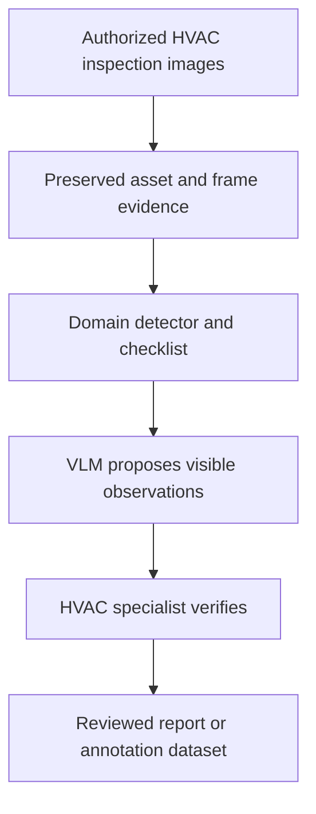

# Future improvements and the HVAC blueprint

Everything in this document is **proposed work**, not a capability delivered by the current app. Priorities and acceptance checks are suggestions for the next experiments. No production deployment, retraining, model replacement or database change is part of the documentation update.

The current cup experiment is a **blueprint for future VLM-assisted visual inspection**, including the HVAC idea. Its reusable pattern is to preserve source evidence, run a detector, ask a VLM a narrow question, validate structured observations, and let a person decide what is useful. The cup results do not establish HVAC performance.

## Recommended progression

| Priority | Improvement | Evidence needed before advancing |
| --- | --- | --- |
| 1 | Evaluate on independent recordings with reference boxes and blinded review. Include empty scenes, jars, occlusion, low light and failed model calls. | Report verified leads and missed errors with counts and denominators. Split by recording/site, rather than neighboring frames. Freeze prompts before evaluation. |
| 2 | Measure and reduce review cost. Compare full-frame YOLO, tiled YOLO and regional Qwen on identical images. Explore adaptive regions, caching and an explicit review budget. | Separate cropping benefits from VLM benefits. Measure end-to-end time, reviewer effort, compute and disk use. Preserve the selected-frame alignment contract when changing sampling. |
| 3 | Extend the [local annotation workflow](DATASET_REVIEW.md) with independent adjudication, larger collections and measured localization quality. | A domain reviewer approves each exported label. Trace every label to the original frame and distinguish independent references from model-assisted annotations. |
| 4 | Investigate false positives, duplicate detections, counts and temporal consistency. Group repeated observations into review episodes. | Validate each rule against independent labels. Quantify hallucinations and tracking failures. Track identity changes explicitly and preserve original detector outputs. |
| 5 | Adapt to a defined domain pilot, then add the operational features its users need. | Agree on domain rules, permissions, licensing, data retention, review responsibility and measurable success before deployment. |

The original R1–R4 contract can represent several error types, but the current default only derives possible missed-cup R1 leads. Changing a prompt does not by itself prove that the other rules, new labels or object tracking work. A model/configuration comparison should change one factor at a time and retain negative results.

## How this could support the HVAC idea

An illustrative HVAC pilot would use an authorized inspection recording and a defined asset checklist. A detector could identify selected equipment or components. A VLM could propose visible discrepancies or draft observations with frame references. An HVAC specialist would decide whether each observation is supported and what action, if any, follows.

This is a proposed adaptation. Today's app contains a cup-specific detector filter, schema constraints, prompt and rules. Reuse of the workflow would require deliberate domain changes and new evaluation, rather than treating the current app as an HVAC diagnostic system.

| Reusable foundation | HVAC work still required |
| --- | --- |
| Original media, frame identity, timestamps and hashes | Asset/site/job identity, capture permissions and an HVAC recording protocol. |
| Detector predictions separated from VLM proposals | A component taxonomy, suitable detector/weights and domain-specific positive and negative examples. |
| Small structured observations with raw response receipts | Specialist-defined questions, uncertainty rules and failure examples for each proposed observation. |
| Human review history and verified exports | Specialist review, escalation rules and an agreed report format. |
| Versioned configuration, provenance and tests | Domain benchmarks, site-separated evaluation and controlled migrations for any new schema. |

Possible first questions are whether a defined component is visible, whether a required photograph is missing, or whether an image contains an apparent visible condition worth specialist review. Surface corrosion, damaged insulation or visible moisture could be candidate research categories if a specialist defines their scope and reference labels. They are examples to investigate, not proven capabilities or fault diagnoses.

Ordinary RGB video cannot establish hidden faults or equipment performance on its own. Temperature, pressure, airflow, electrical or acoustic questions may require additional calibrated sensors, telemetry and inspection methods. Any such evidence would need its own timestamps, provenance and validation. The VLM's confidence or fluent wording cannot substitute for those measurements.

## What a pilot should measure

| Measure | Required comparison |
| --- | --- |
| Verified finding precision | Specialist-confirmed useful findings divided by all adjudicated proposals. Report ambiguous and rejected cases. |
| Error coverage | Verified errors found divided by independently identified errors on the declared evaluation surface. Include failures and abstentions. |
| Human effort | Active review/reporting time with and without assistance at comparable coverage. Record model wait separately. |
| Cost per verified finding | Declared labor, compute and storage cost divided by unique verified findings. A zero-finding denominator is inconclusive. |
| Evidence integrity | Identity, source-pixel, revision and checksum checks across the exported evidence. |

The detailed [evaluation proposal](EVALUATION.md) provides a starting protocol, not a completed business dashboard. An early result can be negative or inconclusive. Cup feasibility results, accepted suggestions and passing software tests do not establish general accuracy, HVAC diagnostic accuracy, energy savings or ROI.

## Operational work before broader use

The current app serves one local user on loopback. Remote or multi-user use would need authentication, authorization, tenant/site separation, protected media access, concurrency controls, backups and tested restoration. Phone synchronization, cloud processing and retention/deletion policies would be separate features with explicit data boundaries.

Commercial distribution also needs a repository-license decision and a dependency/model licensing review. The [Ultralytics licensing page](https://www.ultralytics.com/license) and [Qwen model card](https://huggingface.co/Qwen/Qwen3-VL-2B-Instruct) describe their upstream terms. No repository-wide license or customer deployment permission is established by this blueprint.
